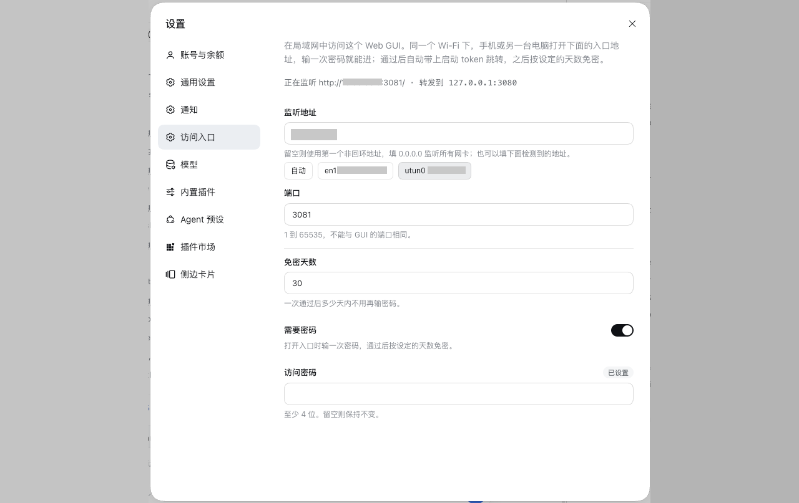

# dsh-access-gateway

[English](README.md) | [简体中文](README.zh-CN.md)

**Access the DSH Web GUI from your LAN.** On the same Wi-Fi, a phone, a tablet or
another computer opens `http://192.168.0.10:3081` and types the password once. Set
the address to `0.0.0.0` and every interface answers — Wi-Fi, VPN, wired.

DSH listens on loopback only and does not accept a wildcard `--host`, so nothing
outside this machine can reach it. This plugin adds that password-gated listener: a
passed login forwards the browser to the loopback GUI with this process's launch
token, so the phone never handles the token.


## Screenshots



## How it works

```
phone → http://192.168.0.10:3081
          │
          ├─ no gateway cookie → password form → 302 to /?token=<launch token>
          │                        └─ cookie set for 30 days
          │
          └─ gateway cookie    → bytes piped to 127.0.0.1:3080
                                  (HTTP keep-alive and WebSocket included)
```

Only each connection's first request head is read. Once a connection proves it
holds the gateway cookie, the rest is a byte pipe, so WebSocket upgrades and
keep-alive work without being understood.

## Install

### 1. Through the Host's `installBundle` (installs **and** enables)

Ask the agent in a conversation:

> install the plugin `github:miiy/dsh-access-gateway`

or paste the same spec into the install field on **Settings → Plugins**.

Both call the Host's `installBundle`, which installs the package, adds it to
`dsh.profile.bundles`, and hot-applies it — one step.

### 2. From the CLI (`dsh plugin`, installs only)

```bash
dsh plugin --profile <profile> add github:miiy/dsh-access-gateway
```

`dsh plugin` forwards its arguments to pnpm inside the profile directory, so this
step installs the package but does **not** compose it. The row then shows up on
**Settings → Plugins** as installed and switched **off**; turn it on to add it to
`dsh.profile.bundles`. If the switch does not take effect live, restart `dsh web`.
A plain-JavaScript bundle has no build script, so a git install needs no
`allowBuilds` approval. A local checkout works too:
`dsh plugin --profile <profile> add /path/to/dsh-access-gateway`.

### 3. Start the Host

Then start the Host as usual. No launch flag is needed: the plugin registers
the address it listens on in the Host's accepted-authority list at runtime, so
`/api` and the WebSocket accept the browser's `Host` as soon as the listener is
up. A wildcard `bind` registers every interface address, so a phone reaches the
entry over Wi-Fi or a VPN without changing the setting. Changing the address in
Settings moves that registration with it, and stopping the plugin takes it away
again.

The Host/Origin fence accepts loopback and the listener's own bind IP by itself;
every other authority has to be named, and a TCP forward cannot rewrite `Host`.
A full HTTP proxy such as `dsh-pocket` needs no entry because it rewrites `Host`
(and `Origin`, `Referer`, `Sec-Fetch-Site`) to the upstream authority on every
request.

`--trusted-host` remains the manual route, and the plugin logs it if it finds no
accepted-authority list to extend:

```bash
dsh --profile web --trusted-host 192.168.0.10
```

## Login page

The gate serves one self-contained page: the product wordmark, one password
field and one button. The prompt sits in the field as its placeholder; a line
appears under the button only to say the password was wrong. The page carries the
Web GUI theme's tokens inlined — the same colours, radii, font stack and control
sizes — so it follows the system light or dark scheme and looks like the
application it opens. Copy follows `Accept-Language`: Chinese for a `zh` browser,
English otherwise. With no password set the page never appears.

## Settings

The Web GUI's Settings page carries an **Access** section: it shows whether the
listener is up and on which URL, and edits the address, the port, the session
lifetime and the gateway password in one form with one Save button. The
interfaces the machine reports are offered as buttons under the address field,
so the address is one tap away and never typed from memory. Saving reopens the
listener on the spot, so no Host restart is needed.

**Require a password** decides whether the entry asks for one at all. Turned off,
every request from that network reaches the GUI: no form, no cookie, no token to
type. That is convenient on a network you trust and wrong on one you do not.

The password field is write-only: an empty field keeps the current password, and
the page only learns whether one is set. The Host stores a scrypt hash, never the
password itself.

## Configuration

These values are the defaults a first run starts from; what the Settings page
saves lives in `~/.dsh/dsh-access-gateway/settings.json` and wins over them.

| Key | Default | Meaning |
| --- | --- | --- |
| `bind` | `''` | Address to listen on. Empty serves the first non-loopback IPv4 the machine reports; `0.0.0.0` serves every interface; a concrete address pins one, such as a VPN address. |
| `port` | `3081` | Listening port. Keep it distinct from the GUI's. |
| `password` | `''` | Gateway password, at least 4 characters. Empty leaves the entry open: anyone who can reach the address gets in. |
| `sessionDays` | `30` | How long one passed login lasts. |

The upstream address is read from the `webServer` service, so the GUI port never
appears in this configuration.

## Security

- The listener serves plain HTTP. Use it on a trusted network or a VPN, or put
  TLS in front of it.
- The password is all that stands between that network and the GUI. With none
  set, every request from the network is admitted, so the Host logs a warning
  and the Settings section shows the entry as open.
- The gateway runs inside the Host process and therefore can read the launch
  token; it holds no other credential and stores the password as a hash.
- A rejected password waits 600 ms before answering, so guessing costs time.
- The gateway cookie is signed with a key kept in
  `~/.dsh/dsh-access-gateway/secret.json` (mode 0600), so a passed login survives a
  Host restart.

## Limits

- No TLS, no tunnel, no QR code: it is an entry for a network you already
  trust, not a way to publish the GUI to the internet.
- One address per profile. A machine that should answer on two interfaces needs
  two rows with different `bind` and `port` values.
