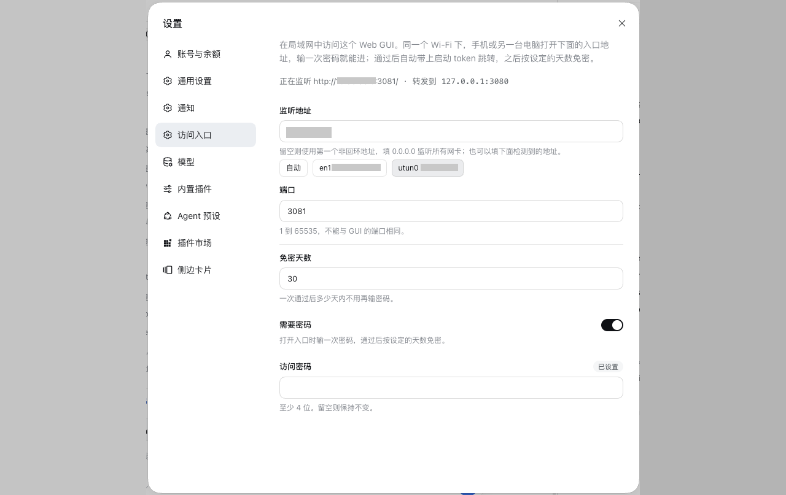

# dsh-access-gateway

[English](README.md) | **简体中文**

**在局域网中访问 DSH Web GUI。** 同一个 Wi-Fi 下，手机、平板或另一台电脑打开
`http://192.168.0.10:3081`，输一次密码就进；地址填 `0.0.0.0` 则所有网卡一起监听，
Wi-Fi、VPN、有线都能进。

DSH 只监听回环地址，也不接受通配的 `--host`，所以本机之外进不来。这个插件补的就是那道
带密码的入口：通过后把浏览器转发到回环上的 GUI，并带上当前进程的启动 token，手机上不碰 token。


## 截图



## 工作方式

```
手机 → http://192.168.0.10:3081
         │
         ├─ 没有网关 cookie → 密码表单 → 302 到 /?token=<启动 token>
         │                     └─ cookie 有效期 30 天
         │
         └─ 有网关 cookie    → 字节透传到 127.0.0.1:3080
                               （HTTP keep-alive 与 WebSocket 一并透传）
```

每个连接只读第一个请求头。连接一旦证明自己带着网关 cookie，后续就是纯字节管道，
所以 WebSocket 升级和长连接不需要被理解也能工作。

## 安装

### 1. 走宿主的 `installBundle`（装上并启用）

在对话里让 agent 装：

> 安装插件 `github:miiy/dsh-access-gateway`

或者把同一个 spec 贴进 **设置 → 插件** 页的安装框。

两条路都走宿主的 `installBundle`：装包、写进 `dsh.profile.bundles`、热生效，一步到位。

### 2. 命令行（`dsh plugin`，只安装）

```bash
dsh plugin --profile <profile> add github:miiy/dsh-access-gateway
```

`dsh plugin` 把参数转给 profile 目录里的 pnpm，所以这一步只装包、**不**组装。装完在
**设置 → 插件** 页会看到这一行是已安装、开关**关着**的状态；把它打开才会加进
`dsh.profile.bundles`。开关没即时生效就重启一次 `dsh web`。

纯 JavaScript 的包没有构建脚本，从 git 安装不需要 `allowBuilds` 审批。本地目录也行：
`dsh plugin --profile <profile> add /path/to/dsh-access-gateway`。

### 3. 启动宿主

然后照常启动宿主即可，不需要任何启动参数：插件在运行时把监听的地址登记进宿主的受信地址列表，
入口一起来，`/api` 和 WebSocket 就认浏览器发来的 `Host`。`bind` 填 `0.0.0.0` 时，每个网卡地址都会登记，
手机走 Wi-Fi 还是 VPN 都不用改设置。在设置页改地址，这条登记跟着走；停用插件，登记随之撤销。

Host/Origin 围栏本身只放行回环地址和监听器自己的绑定 IP，其他地址必须登记，而 TCP 转发改不了 `Host` 头。
`dsh-pocket` 这类完整 HTTP 反代不需要登记，因为它会把每个请求的 `Host`（连同 `Origin`、`Referer`、
`Sec-Fetch-Site`）改写成上游地址。

`--trusted-host` 仍是手工方式；插件找不到可扩展的列表时会打印这一行：

```bash
dsh --profile web --trusted-host 192.168.0.10
```

## 登录页

网关自己渲染一个自带样式的页面：产品字标、一个密码框、一个按钮。提示文字在框里当
placeholder，只有密码输错时按钮下面才出现一行红字。
页面内联了 Web GUI 主题的 token —— 同样的配色、圆角、字体和控件尺寸 —— 跟随系统深浅色，
看上去就是这个应用自己的页面。文案按 `Accept-Language` 取：`zh` 浏览器给中文，其余给英文。

## 设置

Web GUI 的设置页里有一节 **访问入口**：显示入口是否在监听、监听在哪个地址，
地址、端口、免密天数、访问密码在同一张表单里，只有一个保存按钮。机器上报的网卡地址列在地址框下方，点一下就填入，
不用凭记忆手敲。保存后入口当场按新设置重启，不需要重启宿主。

**需要密码** 决定入口要不要密码。关掉之后，那个网络里发来的请求直接进 GUI：没有表单、没有 cookie、
也没有要记住的密码。网络信得过时省事，信不过就是敞开的。

密码框是只写的：留空表示保持不变，页面只知道"已设置"；宿主存的是 scrypt 哈希，不是密码本身。

## 配置

下面这些是首次启动的默认值；设置页保存的内容写在 `~/.dsh/dsh-access-gateway/settings.json` 里，优先于它们。

| 键 | 默认 | 含义 |
| --- | --- | --- |
| `bind` | `''` | 监听地址。留空则用机器上报的第一个非回环 IPv4；`0.0.0.0` 监听所有网卡；填写可固定某个地址，例如 VPN 地址。 |
| `port` | `3081` | 监听端口，别和 GUI 的重复。 |
| `password` | `''` | 网关密码，至少 4 位。留空则不设密码：能连到这个地址的人都能进。 |
| `sessionDays` | `30` | 一次通过后免密的天数。 |

上游地址从 `webServer` 服务读取，所以 GUI 的端口不会出现在这份配置里。

## 安全

- 监听的是明文 HTTP。请用在可信网络或 VPN 里，或者在它前面放 TLS。
- 密码是那个网络和 GUI 之间唯一的屏障。不设密码时，网络里发来的请求一律放行，所以宿主启动时会打一条警告，设置页也把入口标成敞开。
- 网关运行在宿主进程内，因此能读到启动 token；除此之外不持有任何凭据，密码只存哈希。
- 密码错误时延后 600 ms 才回复，猜密码要付时间成本。
- 网关 cookie 用 `~/.dsh/dsh-access-gateway/secret.json`（权限 0600）里的密钥签名，所以宿主重启后登录状态仍在。

## 限制

- 没有 TLS、没有隧道、没有二维码：它是给已经信任的网络用的入口，不是把 GUI 发布到公网的手段。
- 一个 profile 只能一个地址。要在两个网卡上都能访问，就配两行，`bind` 和 `port` 各不相同。
